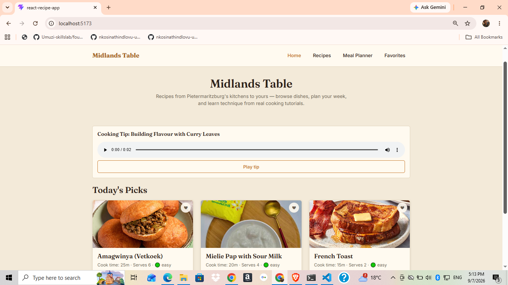
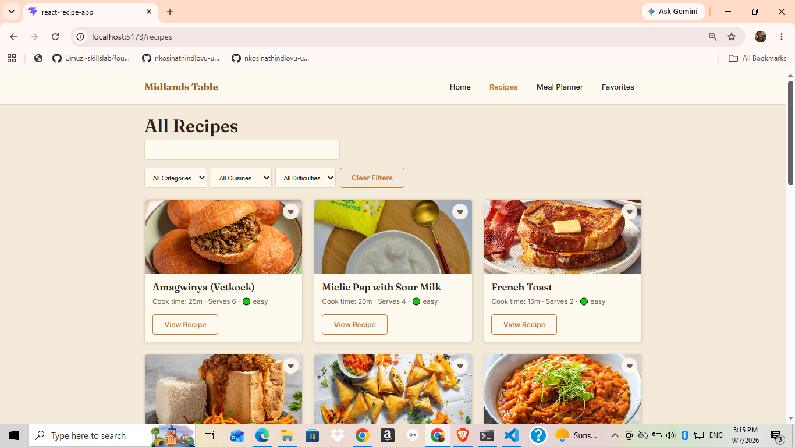
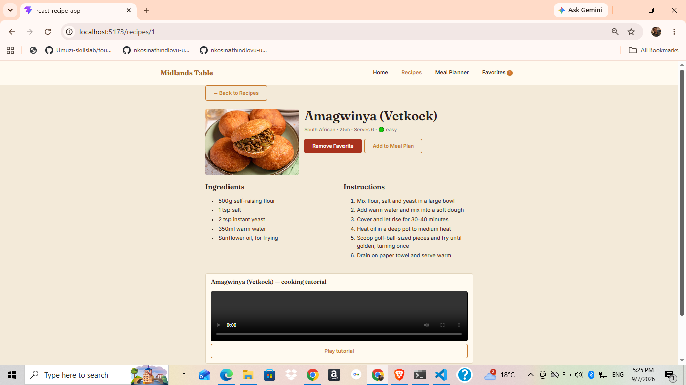
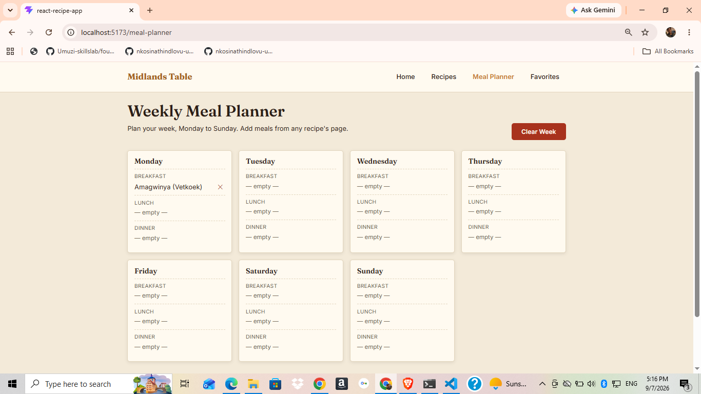
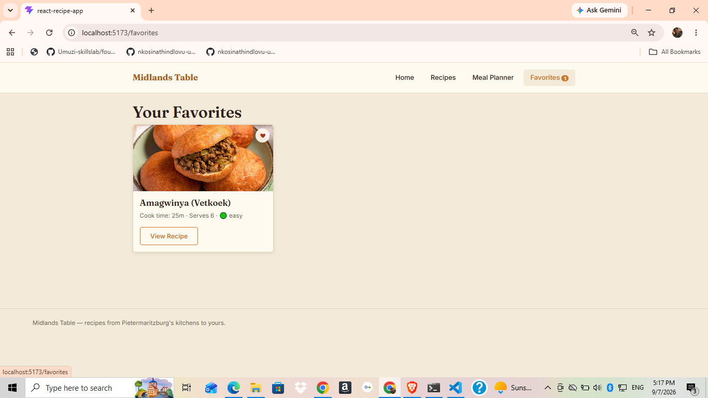
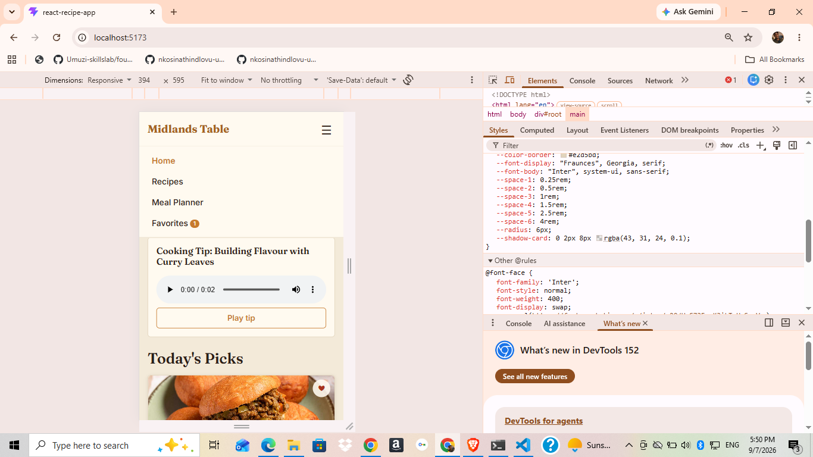

# Midlands Table

A recipe discovery and weekly meal-planning app built with React. Built for a fictional
Pietermaritzburg cooking school that partners with local food bloggers — browse recipes,
watch cooking tutorials, plan your week, and save favorites.

## Features

- Browse and search recipes by title, with dropdown filters for category, cuisine, and difficulty
- Full recipe detail pages with ingredients, step-by-step instructions, and an embedded
  cooking tutorial video for every recipe (with play/pause controls and a progress bar)
- A cooking-tip audio guide on the Home page ("Building Flavour with Curry Leaves")
- Favorite/unfavorite any recipe, saved in this browser's localStorage so they are still
  there after a refresh or when you open the browser again
- A Monday–Sunday meal planner with breakfast/lunch/dinner slots per day, also saved in
  localStorage, with a progress bar for each day
- Clear messages when something goes wrong: an error with a "Try again" button if the
  recipes can not load, and a warning if the saved data in the browser is broken
- Responsive navigation with a mobile hamburger menu and active-route highlighting
- A custom 404 page for unmatched routes

## Technologies Used

- React 19 (functional components + hooks only, no class components)
- React Router DOM (routing, dynamic routes, programmatic navigation)
- PropTypes (prop validation)
- CSS Modules (scoped component styling) + plain CSS custom properties for design tokens
- Vite (build tooling)
- Browser `localStorage` (persistence)

## Component Architecture

Components are organized by responsibility under `src/components/`:

- **UI/** — generic, reusable building blocks: `Button`, `Card`, `SearchBar`, `Loading`, `Modal`
- **Media/** — `VideoPlayer` and `AudioPlayer`, both wrapping native HTML5 media elements
- **Navigation/** — `Navbar`, with active-route styling and a mobile menu
- **Recipe/** — `RecipeCard`, `RecipeList`, `RecipeFilter`, `RecipeDetail`
- **MealPlanner/** — `MealPlanner` (container) and `DayCard` (reused 7x for Mon-Sun)
- **common/** — `Footer`, `EmptyState`

Route-level screens live in `src/pages/`: `Home`, `RecipesPage`, `MealPlannerPage`,
`FavoritesPage`, `NotFound`.

See `planning/PLANNING.md` for the full component hierarchy and data-flow diagrams.

## How to View

1. Clone the repository to your local machine.
2. Open your terminal in the project's root folder (the folder with `package.json` in it).
3. Run these commands, one at a time:

```bash
npm install
npm run dev
```

4. When `npm run dev` has finished, open the local URL that Vite prints
   (usually `http://localhost:5173`) in your browser (Chrome works best).

To make the production version and view it:

```bash
npm run build
npm run preview
```

### How to see the error states

- **Broken saved data:** open the browser DevTools (F12), go to the Console, run
  `localStorage.setItem("favorites", "not valid")` and refresh the page. A warning shows at
  the top and the app starts with empty favourites instead of crashing.
- **Recipes that can not load:** if the recipe data is empty or a recipe is missing its
  title, ingredients or steps, `loadRecipes()` fails and the page shows
  "Sorry, the recipes could not load" with a "Try again" button.

## Project Structure

```
recipe-app/
|-- public/assets/        images/, videos/ (one tutorial per recipe), audio/ (the cooking tip)
|-- src/
|   |-- components/       organized by feature (UI, Media, Navigation, Recipe, MealPlanner, common)
|   |-- pages/            one file per route
|   |-- data/             recipesData.js -- the recipe "database"
|   |-- utils/            helpers.js -- formatting/filtering functions
|   |-- App.jsx           top-level state + routing
|   `-- main.jsx          React entry point
|-- planning/             planning document (component hierarchy, data flow, state strategy)
`-- screenshots/          app screenshots referenced below
```

## Component Descriptions

- `RecipeCard` -- one recipe's summary (image, title, cook time, difficulty, favorite button)
- `RecipeList` -- maps an array of recipes into `RecipeCard`s, or shows an empty state
- `RecipeDetail` -- full recipe page reached via the dynamic route `/recipes/:id`; includes
  the video tutorial and a modal for adding the recipe to the meal plan
- `MealPlanner`/`DayCard` -- the 7-day planner grid; `DayCard` is one reusable component
  rendered once per day
- `Navbar` -- top navigation; shows a badge with the current favorites count

## State Management

Top-level state (`recipes`, `favorites`, `mealPlan`, `isLoading`, `error`, `storageMessage`)
lives in `App.jsx` and is passed down to pages as props. This is "lifting state up", since
several pages (Recipes, Favorites, Meal Planner, Recipe Detail) all need to read or update
the same data.

Complex state is used in three components:

- `App`: `favorites` (an array of recipes) and `mealPlan` (an object with a key for each day)
- `RecipesPage`: one `filters` object holding the search term, category, cuisine and difficulty
- `RecipeDetail`: a `planChoice` object holding the day and meal picked in the "Add to meal plan" form

All of them are updated without mutating, using the spread syntax
(for example `{ ...previous, [name]: value }`).

**Saving in the browser.** `favorites` and `mealPlan` are read from `localStorage` inside
their `useState` initialisers (`loadSavedData()` in `src/utils/storage.js`), so they are
restored before the first render. Two `useEffect` hooks then write them back whenever they
change. Because the saved values are read first, the save effects never write empty values
over them, even with React StrictMode on. If the saved data is broken, the app starts with
empty values and shows a warning. The data is saved in this one browser only, not across
devices.

**Loading.** A third `useEffect` loads the recipes with `loadRecipes()`
(`src/utils/loadRecipes.js`). It works like a fetch: it gives back a Promise, checks the
data, and rejects if the data is missing or incomplete. Then the error message shows.

## Styling

- CSS Modules for each feature folder, with shared colour and spacing tokens in `index.css`
- Conditional classes, for example the active nav link, the open mobile menu and the
  favourite heart
- Inline styles driven by props or state:
  - `RecipeCard`: the difficulty badge colour comes from the recipe's difficulty
  - `DayCard`: the width and colour of the progress bar come from how many meals are planned
  - `VideoPlayer` and `AudioPlayer`: the progress bar width follows the playing time

## Media

Every recipe has its own tutorial video in `public/assets/videos/`. Each one is a short
narrated slideshow made from the dish's photo, ingredients and steps, with a text-to-speech
voice reading each step. The Home page plays a short narrated cooking tip from
`public/assets/audio/curry-leaves-tip.mp3`.

## Routing

| Route | Page |
|---|---|
| `/` | Home |
| `/recipes` | RecipesPage |
| `/recipes/:id` | RecipeDetail (dynamic route) |
| `/meal-planner` | MealPlannerPage |
| `/favorites` | FavoritesPage |
| `*` | NotFound (404) |

## Future Enhancements

- Replace the slideshow tutorials with filmed cooking footage
- Drag-and-drop reordering in the meal planner
- A "generate shopping list" feature derived from the week's planned meals
- User accounts, so favorites/meal plans sync across devices instead of just one browser

## Screenshots







